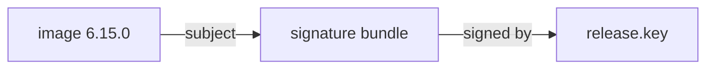

# Where The Signature Lives In The Registry

A signature is only useful if a verifier can find it, and cosign does not keep a separate signature server. It stores the signature in the same registry as the image. This part looks at what cosign v3 pushed when it signed the release, and how the registry links it to the image.

## A Sigstore bundle attached as a referrer

cosign v3 packages every signature as a **Sigstore bundle**: one JSON document that holds the signature, a hint about the key that made it, and, when a log or timestamp authority was used, their evidence. With the offline signing configuration, the bundle holds the signature and the key hint only.

cosign then pushes the bundle into the registry as an **OCI referrer**. A referrer is an artifact whose manifest has a `subject` field that points at another manifest, here the image you signed. A registry that supports the OCI distribution specification 1.1 answers a "referrers" request for a digest with the list of artifacts that point at it. That is how a verifier finds the signature without knowing its name.



The diagram shows the bundle pointing back at the image through its `subject` field; the bundle itself records which key signed it.

## Look at the signature in the registry

`cosign tree` lists everything cosign knows that is attached to an image. Run it for the signed digest; the commands below need the variables `REPO`, `SC` and `DIGEST` set as before.

<!-- astrona:playground:renew -->

```sh
export COSIGN_PASSWORD=lab-only-password
REPO=$REGISTRY/inventory/podinfo
SC=/setup/offline-signing-config.json
DIGEST=$(regctl image digest $REPO:6.15.0)
cosign tree --allow-http-registry $REPO@$DIGEST
```

The tree shows the image and, under it, the signature attached to it. Run the same command for the old release, `6.14.1`, and the tree shows no signature, because you signed only the current release.

`regctl` reads the same link from the registry side. `regctl artifact list` asks the registry for the referrers of a digest:

```sh
regctl artifact list $REPO@$DIGEST
```

The list has one entry: the signature bundle, with an artifact type that names the Sigstore bundle media type. The registry stored it like any other manifest; only the `subject` field makes it a referrer.

## Old signatures and the legacy layout

You will still meet the layout cosign v2 used, because many registries hold signatures made before cosign v3. cosign v2 stored a signature as an image with a special tag, made from the image digest: `sha256-<hex>.sig`. Tools found it by computing that tag.

cosign v3 can still read and write that layout. The flag `--registry-referrers-mode` chooses how cosign looks for attached artifacts: `oci-1-1` uses the referrers API, and `legacy` uses the tag layout. Registries that do not support the referrers API get a fallback tag as well, so the link works either way. For this course you never need to set the flag; it matters when you work with an old registry or old signatures.

You now know where the signature is and how a verifier finds it: by asking the registry for the referrers of a digest. The open question is how the verifier checks that the bundle really belongs to your key and your image.

## Common pitfalls

> [!WARNING]
> - **Looking for `.sig` tags only.** cosign v3 stores bundles as referrers, so a `regctl tag ls` that shows no `.sig` tag does not mean the image is unsigned. Use `cosign tree` or `regctl artifact list`.
> - **Copying an image without its referrers.** Copying a tag to another registry copies the image, not necessarily the artifacts that point at it. Check the target with `cosign tree` after a copy.
> - **Deleting "unknown" manifests from the registry.** Signatures are manifests too. A cleanup job that deletes untagged manifests can delete signatures.
