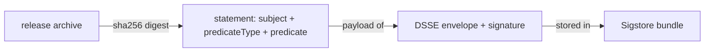

# The In-toto Statement For A File

A signature on a file says that a key holder approved these bytes. It does not say how the file was built, from which commit, or with what tools. An attestation adds those facts in a signed form. This part explains the structure of an attestation for a file: the in-toto statement, its subject and its predicate.

## The in-toto statement

An **attestation** is a signed statement about one or more software artifacts. Sigstore uses the in-toto statement format. A statement is a JSON document with these fields:

- `subject`: the artifacts the statement is about. Each subject has a name and a `digest`, for example a `sha256` hash. For a file, the digest is the hash of the file.
- `predicateType`: a URI that names the kind of fact in the predicate.
- `predicate`: the fact itself, a JSON object whose shape depends on the type.

The statement is wrapped in a **DSSE envelope** (Dead Simple Signing Envelope): the payload is the statement, encoded as base64, and the envelope carries the signatures over it. cosign puts the envelope into a Sigstore bundle, so one file holds everything.



The diagram shows the order: the digest of the file goes into the subject, the statement goes into the envelope, and the envelope goes into the bundle.

## Why the subject matters

The subject digest ties the statement to one file. If someone later gives you another file and the old bundle, the digests differ, and verification fails. An attestation therefore cannot be moved to another artifact. This is the property that makes a build record trustworthy.

## Create an archive to attest

Make a small release archive and a build record that will become the predicate:

<!-- astrona:playground:renew -->

```sh
export COSIGN_PASSWORD=lab-only-password
SC=/setup/offline-signing-config.json
mkdir -p /work/keys /work/rel && cd /work/keys && cosign generate-key-pair --output-key-prefix release && cd /work/rel
mkdir -p tool-1.0 && printf 'tool 1.0\n' > tool-1.0/README
tar -czf tool-1.0.tar.gz tool-1.0
cat > build.json <<'EOF'
{"builder": "ci.example", "commit": "8c1d0f4", "reproducible": true}
EOF
sha256sum tool-1.0.tar.gz
```

The `sha256sum` value is what cosign will write into the subject of the statement. In the next part you create the attestation and compare the two.

You now know the shape of an attestation: a subject that names the file by hash, a predicate type and a predicate. The next part builds one with `cosign attest-blob`.


## Common pitfalls

> [!WARNING]
> - **Confusing the predicate with the subject.** The subject is the file; the predicate is the fact about it.
> - **Treating the bundle as only a signature.** It holds a signed statement with a payload you can read.
> - **Putting secrets in the predicate.** The payload is only encoded, not encrypted.
