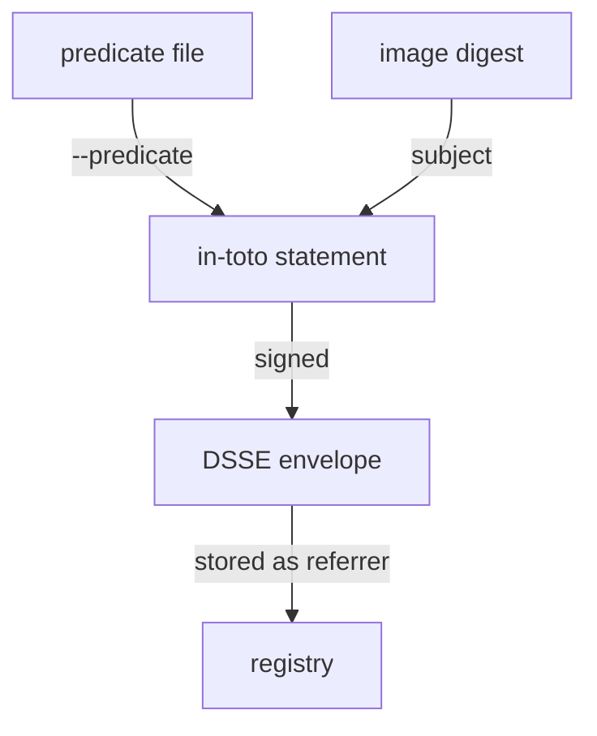

# In-Toto Statements And Predicate Types

A build system knows how an image was made, and a scanner knows what is inside it. To pass that knowledge on, both need a common format that says what the fact is about and what kind of fact it is. This part explains that format, the in-toto statement, and the predicate types cosign supports.

## The three parts of a statement

An **in-toto statement** is a small JSON document from the in-toto attestation framework, an open standard for supply chain metadata. It has three parts:

| Field | What it holds |
| --- | --- |
| `subject` | The artifacts the statement is about: a list of names with their digests |
| `predicateType` | A URI that says what kind of fact this is, for example SLSA provenance |
| `predicate` | The fact itself, in the format that `predicateType` defines |

The statement also has a `_type` field that names the statement format version. When cosign attests an image, it builds the statement for you: it puts the image digest into `subject`, the URI for your `--type` into `predicateType`, and your file into `predicate`. Then it signs the statement in a DSSE envelope (Dead Simple Signing Envelope), a wrapper that holds a base64 payload and the signatures over it. That signed envelope is the attestation.



The diagram shows cosign wrapping your predicate and the image digest into a statement, signing it, and storing the result next to the image.

## Look at the example predicates

The playground puts two predicates in `/work/predicates`. Look at the SLSA provenance first:

<!-- astrona:playground:renew -->

```sh
jq . /work/predicates/provenance.json
```

**SLSA provenance** describes how an artifact was built. SLSA (Supply-chain Levels for Software Artifacts) defines it in version 1 with two parts. `buildDefinition` says what was built: the build type, the source repository and tag, and the resolved dependencies such as the exact commit. `runDetails` says who built it: `builder.id` names the build system, and `metadata` holds the run ID and the start and finish times. A policy that trusts only one builder checks `runDetails.builder.id`.

Now the vulnerability scan:

```sh
jq '{scanner: .scanner.uri, db: .scanner.db.version, findings: [.scanner.result.Results[].Vulnerabilities[] | {VulnerabilityID, Severity}]}' /work/predicates/vuln.json
```

This predicate follows cosign's own vulnerability format. `invocation` says which pipeline ran the scan, `scanner` names the scanner, its version, its vulnerability database, and its raw `result` (here a Trivy report), and `metadata` holds the scan start and finish times. The scan of 6.15.0 found one low-severity issue.

## The predicate types cosign knows

`cosign attest --type` takes a short name and turns it into the `predicateType` URI. These are the values cosign v3.1.4 accepts:

| `--type` | `predicateType` | Used for |
| --- | --- | --- |
| `slsaprovenance1` | `https://slsa.dev/provenance/v1` | SLSA provenance version 1 |
| `slsaprovenance`, `slsaprovenance02` | `https://slsa.dev/provenance/v0.2` | The older SLSA provenance version |
| `spdx`, `spdxjson` | `https://spdx.dev/Document` | An SPDX SBOM |
| `cyclonedx` | `https://cyclonedx.org/bom` | A CycloneDX SBOM |
| `vuln` | `https://cosign.sigstore.dev/attestation/vuln/v1` | cosign's vulnerability scan format |
| `openvex` | `https://openvex.dev/ns` | A VEX document: which vulnerabilities do or do not affect the image |
| `link` | `https://in-toto.io/Link/v1` | An in-toto link from a build step |
| `custom` | `https://cosign.sigstore.dev/attestation/v1` | Anything else, the default |

You can also pass your own URI as `--type`. Pick the precise type: a verifier asks for attestations of one type, and a policy is written for one predicate format.

cosign checks some predicates before it signs them. For `vuln` it reads the file into its vulnerability format, and for `slsaprovenance1` it checks the predicate against the SLSA v1 format, so a file with the wrong shape is refused at signing time rather than later.

You now know what an attestation contains and which type to choose for provenance, scans and SBOMs. The open question is how to attach one to the release and read it back.

## Common pitfalls

> [!WARNING]
> - **Putting the subject into the predicate file.** cosign builds the `subject` from the image you attest. The predicate file holds only the predicate.
> - **Using `custom` for everything.** A verifier and a policy look for a specific `predicateType`. A scan attested as `custom` is not found by `--type vuln`.
> - **Mixing up SLSA versions.** `slsaprovenance` is v0.2; `slsaprovenance1` is v1, with `buildDefinition` and `runDetails`.
> - **Treating a predicate file as evidence.** Until it is signed and attached, it is just a file anyone could write.
